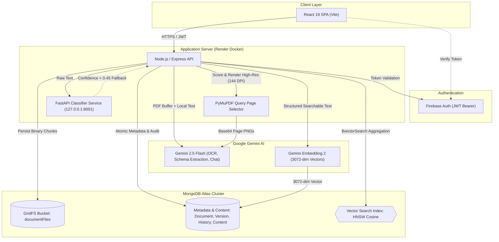

# Arckiv — AI-Powered Document Intelligence Platform

> High-throughput document management system integrating custom supervised text classification, multimodal LLM extraction, vector similarity retrieval, and query-guided visual PDF understanding.

**Live Application:** [arckiv.web.app](https://arckiv.web.app) | **API Status:** [arckiv-api.onrender.com/health](https://arckiv-api.onrender.com/health)

---

## Overview

Traditional document management systems rely on manual folder hierarchies and brittle keyword indexes that fail to parse heterogeneous, unstructured files. Arckiv resolves this by coupling an in-house supervised classifier with multimodal document intelligence, enabling automated schema extraction, hybrid vector search, and visual conversational reasoning over complex documents.

---

## AI & Machine Learning Architecture

Arckiv implements a tiered AI architecture combining an in-house trained supervised classifier for deterministic categorisation with pretrained multimodal foundation models for extraction, semantic retrieval, and conversational interaction.

| AI/ML Component | Verified Model / Algorithm | Input | Processing Approach | Output |
| :--- | :--- | :--- | :--- | :--- |
| **Document Classification** | TF-IDF + Logistic Regression (`v2-f0f7e2d35969`) | Preprocessed document text (`pdf-parse` / OCR) | Calibrated supervised classifier ($T=0.45$ threshold); falls back to Gemini on low confidence | Verified category (`Invoice`, `Receipt`, `Certificate`, `Report`) |
| **Semantic Vector Retrieval** | `gemini-embedding-2` + Atlas Vector Search | Structured metadata + summary + content (3k chars) | 3072-dimensional vector embedding indexed via Hierarchical Navigable Small World (HNSW) graphs | Top-$k$ semantically relevant documents |
| **Document Intelligence & OCR** | Google `gemini-2.5-flash` | PDF / image binary buffer + OCR text | Multimodal zero-shot prompt with schema-constrained JSON extraction | Summary, category tags, and typed key-value fields |
| **Visual PDF Understanding** | PyMuPDF (`fitz`) + `gemini-2.5-flash` | Multi-page PDF + natural language query | Multi-word phrase & keyword frequency scoring; dynamic 144 DPI page rendering | Base64 high-resolution page images for multimodal reasoning |
| **Conversational RAG** | Google `gemini-2.5-flash` | Chat history, prompt, rendered pages & text excerpts | Sub-document chunk scoring (24k char budget) + multimodal visual ground-truth prompt | Context-grounded conversational answers |

Vector retrieval computes cosine similarity between the query embedding $\mathbf{q}$ and stored document vectors $\mathbf{d} \in \mathbb{R}^{3072}$:

$$\text{Cosine Similarity}(\mathbf{q}, \mathbf{d}) = \frac{\mathbf{q} \cdot \mathbf{d}}{\|\mathbf{q}\|_2 \|\mathbf{d}\|_2} = \frac{\sum_{i=1}^{3072} q_i d_i}{\sqrt{\sum_{i=1}^{3072} q_i^2} \sqrt{\sum_{i=1}^{3072} d_i^2}}$$

*Academic Note:* Gemini models provide pretrained API inference via the `@google/genai` SDK. In-house engineering focused on model calibration, threshold optimisation ($T=0.45$), visual PDF rendering heuristics, atomic transactions, and hybrid retrieval architecture.

---

## Key Features

- **Dual-Engine Document Classification:** High-speed in-house scikit-learn classifier with calibrated confidence scoring and automated Gemini fallback.
- **Multimodal Visual PDF Understanding:** Dynamic query-driven page relevance scoring via PyMuPDF with selective 144 DPI page rendering for visual document reasoning.
- **Hybrid Semantic Search:** MongoDB Atlas Vector Search on 3072-dimensional embeddings combined with user-isolated regex keyword search and deduplication.
- **Adaptive Structured Extraction:** Zero-hallucination key-field extraction adapting dynamically to document types with verbatim attribute preservation.
- **Cryptographic Provenance & Sharing:** Immutable document audit logs (`DocumentHistory`), GridFS binary storage, and time-bound SHA-256 hashed share links.

---

## System Architecture



---

## Technology Stack

| Layer | Technologies | Architectural Responsibility |
| :--- | :--- | :--- |
| **Frontend** | React 19, Vite, Tailwind CSS, Framer Motion | Single-page application, interactive modals, responsive document previews |
| **API & Middleware** | Node.js, Express 5, Firebase Admin SDK | REST endpoints, JWT authentication, atomic Mongoose transactions |
| **Storage** | MongoDB Atlas, GridFS Bucket (`documentFiles`) | 1:1 decoupled metadata, content, history, and chunked binary storage |
| **Supervised ML** | Python 3.13, FastAPI, Scikit-learn, Joblib | Local document classifier service (`127.0.0.1:8001`) with manifest validation |
| **Foundation AI** | Google Gemini 2.5 Flash, Gemini Embedding 2 | Multimodal document analysis, structured extraction, vector embeddings |
| **PDF Processing** | PyMuPDF (`fitz`), `pdf-parse` | Local text extraction and query-directed 144 DPI high-resolution page rendering |

---

### Installation & Execution

```bash
# 1. Start Python Classifier Service
cd ml
pip install -r requirements.serve.txt
python serve.py --host 127.0.0.1 --port 8001

# 2. Start Express API Server
cd ../server
npm install
npm run dev

# 3. Start React Frontend
cd ../client
npm install
npm run dev
```
